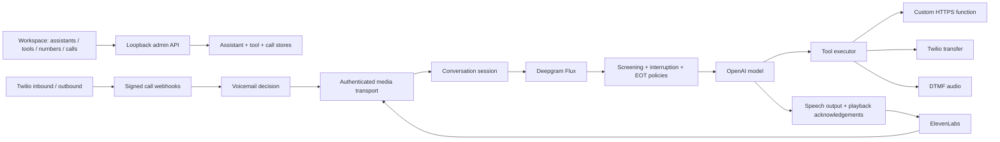

# Calling module architecture

- `lib/config.ts`: shared validated contracts. Provider restrictions and settings are explicit.
- `server/providers/`: transport implementations for each provider; model, transcriber and voice depend on ports, not one another. Inherited proxy/CA trust is honored.
- `server/calls/`: voicemail and screening decisions, independent of language generation.
- `server/speech/`: output pacing, cancellation, mark correlation, G.711/DTMF and interruption rules.
- `server/tools/`: persisted registry, model-visible schemas and function/transfer/DTMF execution. Only attached tools can run. Phrase transfers are not advertised to the model.
- `server/engine/`: per-call orchestration. Partial/eager transcripts cannot execute tools. Interrupted work settles before the next conversational group starts, preserving OpenAI tool protocol ordering. No automatic retry of custom-function side effects.
- `server/http/`: signed Twilio webhooks and media input; separate loopback admin API for CRUD and call control.
- `server/store/`: atomic JSON persistence for assistant configurations, assignments, tools and recent call records. Per-call snapshots freeze assistant and tool settings at call creation. Stream context is bound to the actual call SID and consumed once.
- `app/components/`: assistant settings, reusable tool editor, call controls/history.

## Lifecycle and important semantics

1. An outbound request reserves admission while Twilio creates the call; inbound calls resolve their assigned assistant. Live calls fail early if provider configuration is incomplete.
2. Outbound calls use a signed callback URL. Twilio AMD, when enabled, executes before the stream starts. `DetectMessageEnd` can delay connection to the voice agent.
3. A Twilio `start` event must present the exact saved context, HMAC token and call SID. Contexts expire after ten minutes; a consumed token cannot start another stream. Only 8 kHz, mono mu-law is accepted.
4. Flux final transcripts feed the screening/transfer policies and then OpenAI. Model output is collected per response before speech/tool dispatch, avoiding spoken filler during DTMF. ElevenLabs audio streams as generated. This is not a fully speculative low-latency pipeline.
5. A speech generation owns an abort signal and Twilio playback mark. The mark is awaited before a transfer or hangup; stale marks cannot complete a later generation. Barge-in cancels pending output and clears Twilio's audio buffer.
6. Custom functions receive `Idempotency-Key: <callSid>:<toolCallId>`. The remote function server must enforce idempotency; aborting a request cannot undo an already-applied action.
7. Tool responses are passed back to OpenAI using assistant/tool message pairs. Conversation trimming preserves complete groups. At most six tool rounds run per turn; DTMF waits for the next user/IVR turn.
8. Twilio status updates are monotonic. Transfer outcomes are distinct from transfer initiation. Maximum duration and silence timers bound calls.

## Persistence and deployment

Run one backend process with its own `DATA_DIR`; atomic JSON files are not a distributed database. Do not run multiple writers against one directory. Active sessions/context and detailed traces live in memory. Recent call records persist, but detailed trace playback is unavailable after a restart. Restored nonterminal call records become `failed / server-restarted`, referring to interruption of this server's session, not verified downstream telephony status. A transfer may continue independently at Twilio.

The admin API binds to loopback, and Next.js proxies `/api` to port 8081. Only the voice service on 8080 should receive Twilio public callbacks. There is no multi-user authentication yet; this is a local development workspace, not a public SaaS deployment.

The session currently accepts Twilio-shaped output messages through its `send` port. Meeting support will need a transport adapter and codec/playback mapping. HeyGen/Google Meet are not implemented, and compatibility has not been assumed.
