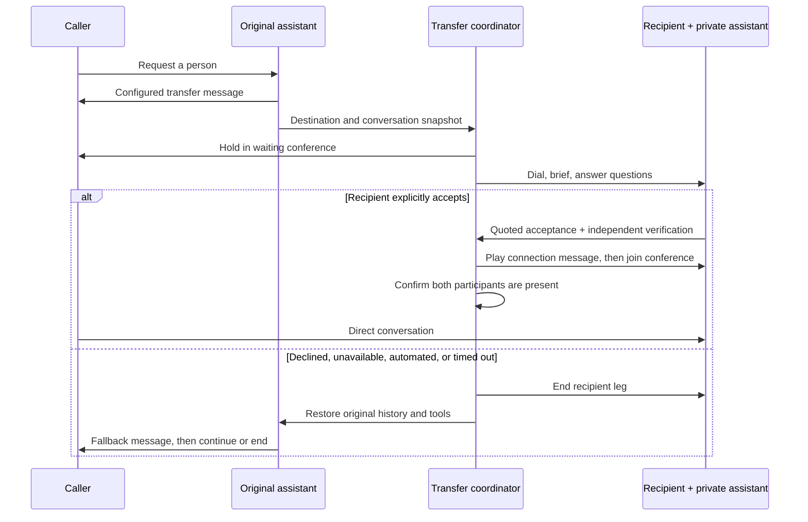

# Agentic warm transfer

In **Tools → Transfer call**, choose **Warm** or **Blind**. Existing tools default to Blind. Both modes support destination-description routing and caller transfer phrases. Attach the tool to an assistant as usual.

Warm transfer uses Twilio for both phone legs and the conference. A separate assistant uses the originating assistant's Deepgram, OpenAI, and ElevenLabs settings to speak privately with the recipient. It can explain why the caller needs help, answer contextual questions, and ask whether the recipient will take the call.

## Settings

| Setting                         | Effect                                                                                                                               |
| ------------------------------- | ------------------------------------------------------------------------------------------------------------------------------------ |
| Operator instructions           | Extra instructions for the private recipient conversation. Use these to specify which details to summarize and questions to answer.  |
| Operator first message          | Optional exact introduction. Empty generates an introduction using the caller's conversation and objective.                          |
| Ring timeout                    | How long Twilio waits for the recipient to answer. The coordinator allows a small additional margin for call creation and callbacks. |
| Consultation limit              | Maximum time for the private recipient conversation, including provider setup and playback. Default 120 seconds.                     |
| Recipient silence timeout       | Maximum idle time while waiting for the recipient. Default 30 seconds.                                                               |
| Connection confirmation timeout | Maximum time to verify both conference members after acceptance. Default 20 seconds.                                                 |
| Message before connecting       | Spoken to the recipient after acceptance and before the bridge. Playback must finish.                                                |
| Fallback message                | Spoken to the caller when the original assistant resumes after an unsuccessful attempt.                                              |
| End after fallback              | Ends the caller's call after confirmed fallback playback; otherwise the original conversation continues.                             |
| Hold audio URL                  | Optional public HTTPS WAV/MP3 supported by Twilio. Empty uses generated audio served by this backend.                                |
| Extension                       | Twilio sends the configured digits after the recipient answers, before starting the consultation stream.                             |

The consultation has only two internal tools: `transferSuccessful` and `transferCancel`. A success request must quote the latest spoken recipient reply. A separate model request with fixed instructions checks for explicit agreement to take this caller. Only its explicit `accept` decision can authorize a bridge; invalid output or any other decision fails closed. This reduces accidental transfers but remains dependent on transcription and model accuracy.

The private assistant cancels on a recognized voicemail, IVR, refusal, or unavailable recipient. It does not leave a voicemail or autonomously navigate an IVR; configured post-answer digits can reach a known extension. The caller cannot hear the private briefing. Once joined, the parties talk directly through Twilio and both AI media sessions leave.

## Recovery and visibility

**Calls** shows the transfer phase, recipient leg, destination and failure reason. Open the linked recipient call to inspect its conversation while the process is running. `connected` requires actual conference membership, not merely a successful redirect API response. `returned` requires the original caller to start a valid replacement media stream.

No-answer, busy, refusal, voicemail/IVR decisions, provider errors, dropped consultation streams, and ring/consultation/bridge deadlines trigger recovery. Recovery first ends the recipient leg and then restores the caller's assistant, history and tools. It retains the original assistant's absolute time limit. If that limit has expired, it ends the caller instead. Caller hangup cancels the recipient leg.

Automatic recovery is limited to three attempts. Persistent provider failures show `recovery-failed` and **Retry caller recovery** in Calls; there is also the regular call hangup control. The original caller can remain on hold until recovery or intervention succeeds. When the backend restarts, it queries live Twilio status, recovers pending consultations without redialing, and preserves native conferences that already connected.

Each warm transfer needs capacity for an additional call leg and incurs Twilio calling/conference and AI usage. Set `MAX_CONCURRENT_CALLS` accordingly. Run one backend process and retain its `DATA_DIR`. Warm-transfer snapshots contain conversation history and are saved locally alongside recent call records. The public HTTPS origin must route all `/twilio/warm/*`, `/twilio/warm-hold.wav`, and `/media` requests to the voice service. Signed Twilio validation and call-bound, one-use stream tokens apply to the new flow.

## Validation and practical limits

Run `npm test`, `npm run typecheck -- --incremental false`, and `npm run build`. Automated tests use isolated provider doubles and exercise the agentic dialogue, acceptance checks, bridge confirmation, webhook signatures, media authentication, timeouts, callback races, restart recovery and fallback playback.

Real phone calls have not been validated in this environment because credentials and provider network access are unavailable. Before use, make controlled calls covering explicit acceptance, recipient questions, refusal, busy/no-answer, voicemail, caller hangup during consultation, and recovery after provider interruption. Verify your destination's extensions and hold audio on Twilio.

No implementation can guarantee every transfer succeeds: carriers, recipients, network outages, transcription and models can fail. Bounded recovery and observable failures are implemented; a multi-process durable queue, cross-provider failover and production load testing are separate work. Native human conferences continue after the assistant hands off and are not limited by its session duration timer.
